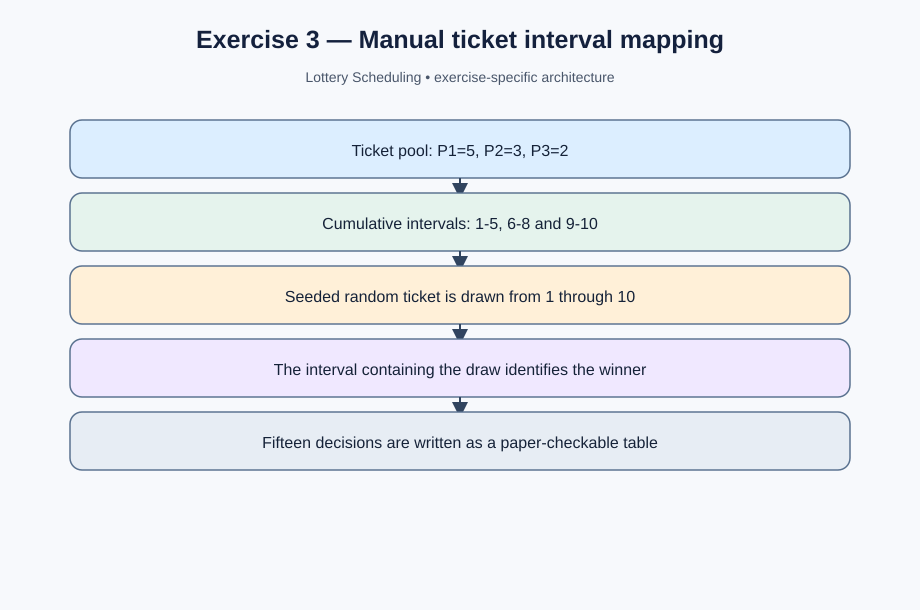
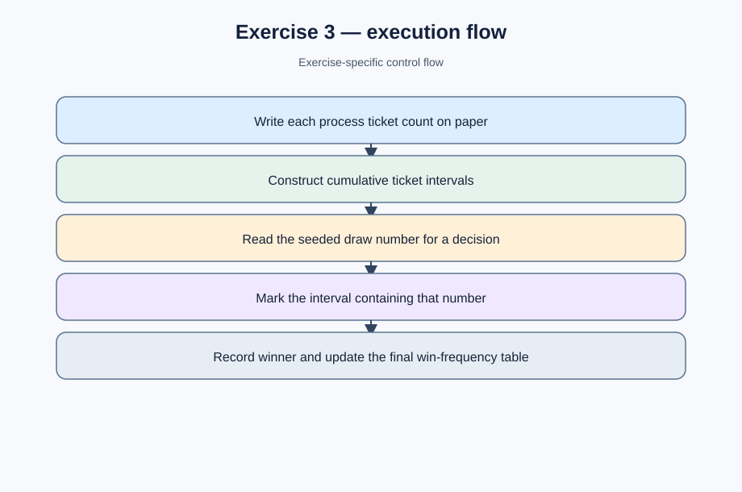
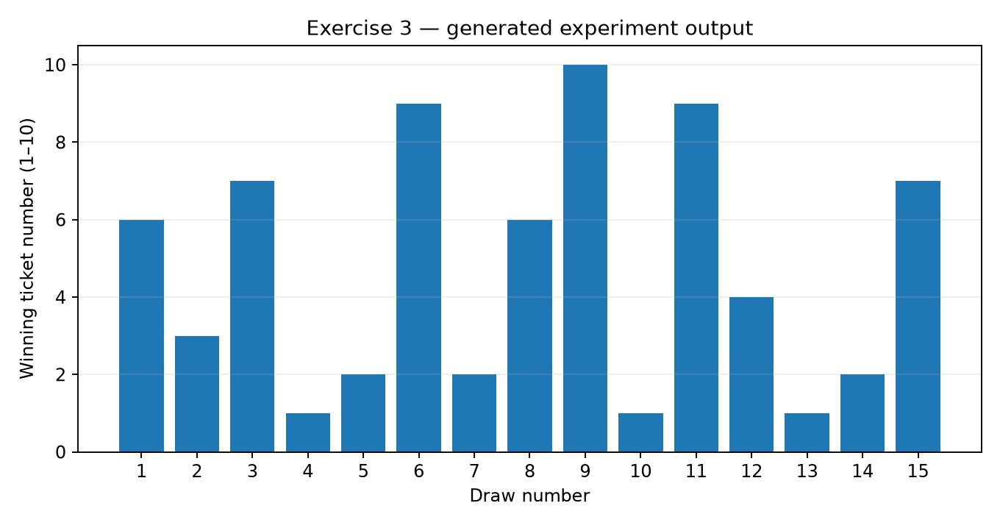

# تمرین 3 — حل دستی قرعه‌ها و جدول اجرای Lottery

**عنوان انگلیسی:** Hand-worked Lottery Draws and Trace Table  
**الگوریتم محوری:** Lottery Scheduling  
**هدف:** محاسبهٔ دستی بازه‌های بلیت، برندهٔ قرعه، ترتیب اجرا و سهم مشاهده‌شده.

## راهنمای تصویری







## اجرا

از ریشهٔ مخزن:

```bash
pip install -r requirements.txt
python exercises/exercise_03-manual-lottery-trace/src/run.py
# جدول ۱۵ قرعه با seed=7: outputs/manual_draws.csv
python -m pytest exercises/exercise_03-manual-lottery-trace/tests -q
```

خروجی‌ها در `outputs/results.json` و جدول قابل‌چاپ قرعه‌ها در `outputs/manual_draws.csv` ذخیره می‌شوند. توضیح علمی، سناریو، محدودیت و تفسیر نمودارها در [راهنمای docs](docs/README.md) آمده است.

## ساختار پوشه

```text
exercises/exercise_03-manual-lottery-trace/
├── README.md
├── src/run.py
├── tests/test_exercise_03.py
├── docs/README.md
├── docs/figures/ (2 SVG + 1 PNG)
├── docs/reports/report_fa.md
├── docs/reports/report_en.md
├── outputs/results.json
└── outputs/manual_draws.csv
```

## نتیجه و محدودیت

محاسبهٔ دستی بازه‌های بلیت، برندهٔ قرعه، ترتیب اجرا و سهم مشاهده‌شده. نتیجه‌ها برای سناریو و seed ثبت‌شده معتبرند؛ آن‌ها را به همهٔ بارهای کاری یا به زمان‌بند kernel تعمیم ندهید.
