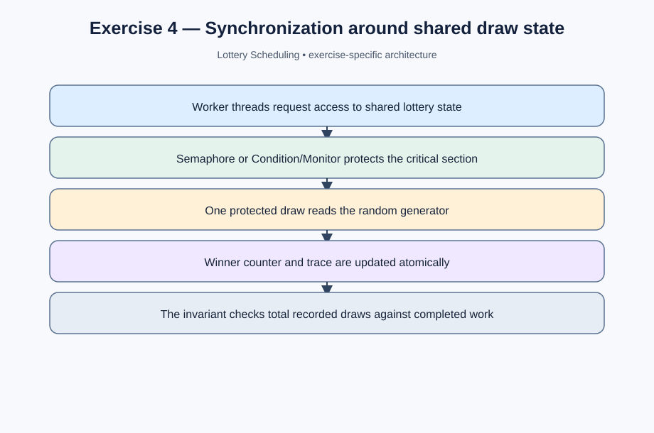
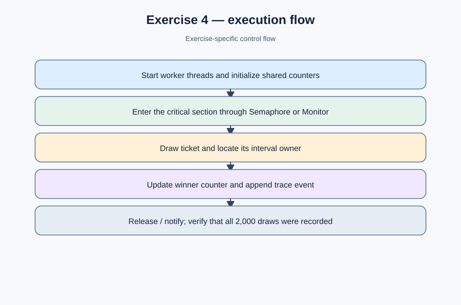
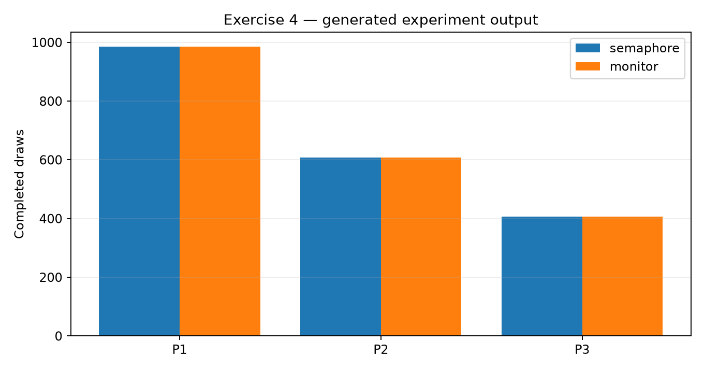

# تمرین 4 — همگام‌سازی و حفاظت از قرعه‌کشی مشترک

**عنوان انگلیسی:** Synchronization and Safe Shared Lottery State  
**الگوریتم محوری:** Lottery Scheduling  
**هدف:** بررسی race condition روی مولد تصادفی و شمارنده‌ها و مقایسهٔ Semaphore و Monitor.

## راهنمای تصویری







## اجرا

از ریشهٔ مخزن:

```bash
pip install -r requirements.txt
python exercises/exercise_04-synchronization-primitives/src/run.py
python -m pytest exercises/exercise_04-synchronization-primitives/tests -q
```

خروجی در `outputs/results.json` ذخیره می‌شود. توضیح علمی، سناریو، محدودیت و تفسیر نمودارها در [راهنمای docs](docs/README.md) آمده است.

## ساختار پوشه

```text
exercises/exercise_04-synchronization-primitives/
├── README.md
├── src/run.py
├── tests/test_exercise_04.py
├── docs/README.md
├── docs/figures/ (2 SVG + 1 PNG)
├── docs/reports/report_fa.md
├── docs/reports/report_en.md
└── outputs/results.json
```

## نتیجه و محدودیت

بررسی race condition روی مولد تصادفی و شمارنده‌ها و مقایسهٔ Semaphore و Monitor. نتیجه‌ها برای سناریو و seed ثبت‌شده معتبرند؛ آن‌ها را به همهٔ بارهای کاری یا به زمان‌بند kernel تعمیم ندهید.
