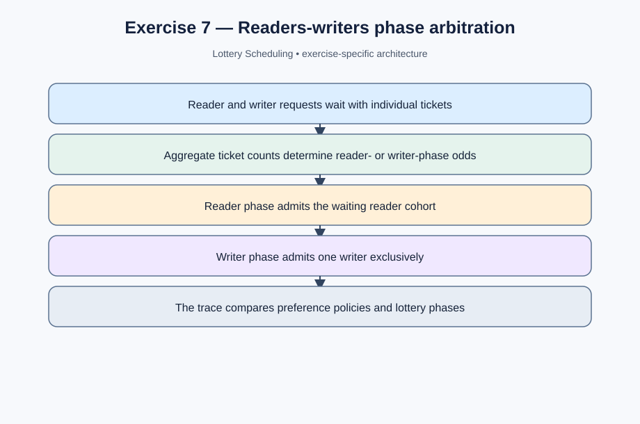
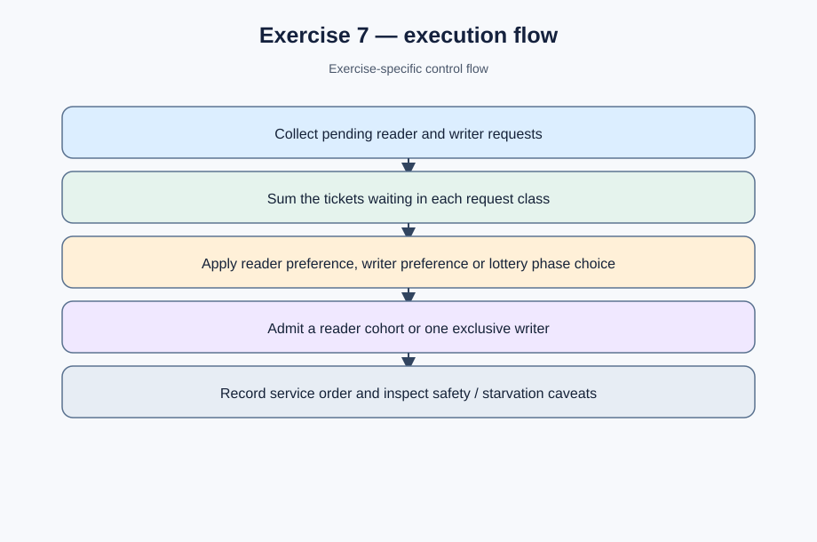
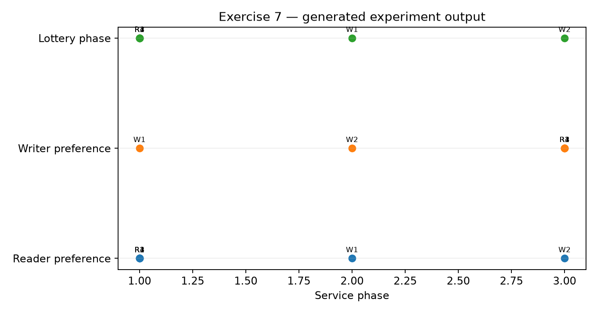

# تمرین 7 — مسئله خوانندگان و نویسندگان با انتخاب بلیت‌محور

**عنوان انگلیسی:** Readers-Writers with Ticket-Based Phase Arbitration  
**الگوریتم محوری:** Lottery Scheduling  
**هدف:** مقایسهٔ reader-preference، writer-preference و lottery-phase با حفظ انحصار نویسنده.

## راهنمای تصویری







## اجرا

از ریشهٔ مخزن:

```bash
pip install -r requirements.txt
python exercises/exercise_07-readers-writers/src/run.py
python -m pytest exercises/exercise_07-readers-writers/tests -q
```

خروجی در `outputs/results.json` ذخیره می‌شود. توضیح علمی، سناریو، محدودیت و تفسیر نمودارها در [راهنمای docs](docs/README.md) آمده است.

## ساختار پوشه

```text
exercises/exercise_07-readers-writers/
├── README.md
├── src/run.py
├── tests/test_exercise_07.py
├── docs/README.md
├── docs/figures/ (2 SVG + 1 PNG)
├── docs/reports/report_fa.md
├── docs/reports/report_en.md
└── outputs/results.json
```

## نتیجه و محدودیت

مقایسهٔ reader-preference، writer-preference و lottery-phase با حفظ انحصار نویسنده. نتیجه‌ها برای سناریو و seed ثبت‌شده معتبرند؛ آن‌ها را به همهٔ بارهای کاری یا به زمان‌بند kernel تعمیم ندهید.
